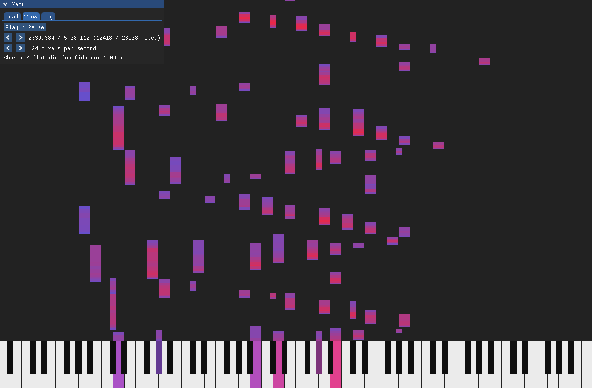

# Ricordanza

## About

**Ricordanza** is a pitch visualizer/transcriber intended for piano recordings,
powered by Spotify's Basic Pitch model. To use it, simply load an audio file,
adjust any transcribing options, and click "transcribe" to see the results. Includes
playback synced to the piano roll and basic chord detection.

## License

Ricordanza is licensed under the MIT license; see [LICENSE.txt](./LICENSE.txt) for more information.
